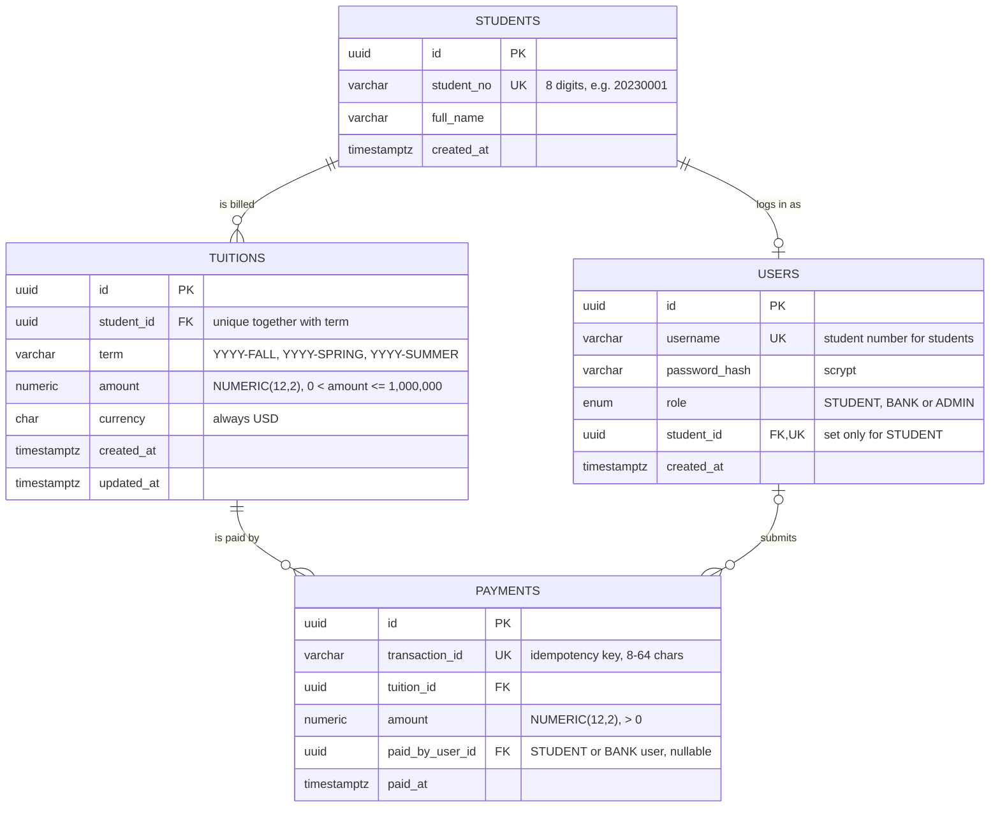

# Data model (ER diagram)

Database: PostgreSQL 16. The schema is defined in [`apps/tuition-api/prisma/schema.prisma`](../apps/tuition-api/prisma/schema.prisma) and created by the migration in [`apps/tuition-api/prisma/migrations/`](../apps/tuition-api/prisma/migrations/).

## Tables

| Table | Purpose | Keys and constraints |
|---|---|---|
| `students` | Student master data. Not created by tuition operations (Add Tuition returns `404 STUDENT_NOT_FOUND` for an unknown student). | `student_no` unique, must be 8 digits |
| `users` | Login accounts for the three roles. A `STUDENT` user is linked to exactly one student; `BANK` and `ADMIN` users are not. | `username` unique; `student_id` unique; CHECK: `student_id` is set if and only if `role = STUDENT` |
| `tuitions` | Assessed tuition for one student and one term. | Unique (`student_id`, `term`), which is the key of the Add Tuition upsert; CHECK on term format, `0 < amount ≤ 1,000,000`, `currency = 'USD'` |
| `payments` | Simulated payments. Many partial payments can belong to one tuition record. | `transaction_id` unique (idempotency key, `409 DUPLICATE_TRANSACTION`); CHECK `amount > 0` and transaction ID format |

## Design notes

- **Balance is not stored.** `balance = tuitions.amount − SUM(payments.amount)` is computed on every query, so it can never drift out of sync with the payments (README §12.5).
- **Money** uses `NUMERIC(12,2)` (exact decimal). The API rejects inputs with more than 2 decimals, so values are never rounded.
- **Overpayment protection.** The Pay Tuition operation locks the tuition row (`SELECT … FOR UPDATE`) inside a transaction, computes the balance and only then inserts the payment. Together with the unique `transaction_id`, two simultaneous requests can neither overpay nor double-record.
- **Defense in depth.** The CHECK constraints repeat the API's validation rules at database level. Prisma cannot express CHECK constraints, so they are added by hand at the end of the migration SQL.
- **Deletes are restricted.** A student with tuition records, or a tuition record with payments, cannot be deleted. Payment history is kept even if a user account is removed (`paid_by_user_id` is set to `NULL`).
- **Indexes:** `tuitions(term)` supports the Unpaid Tuition Status query, and `payments(tuition_id)` supports the balance sum.
- The JWT `studentNo` claim comes from `users → students.student_no`. The AI Agent never takes a student number from the prompt (README §12.3).
